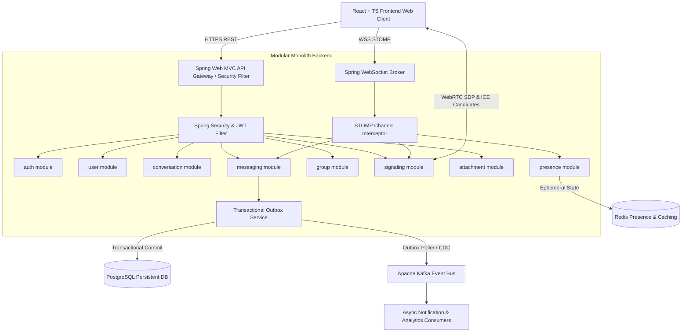
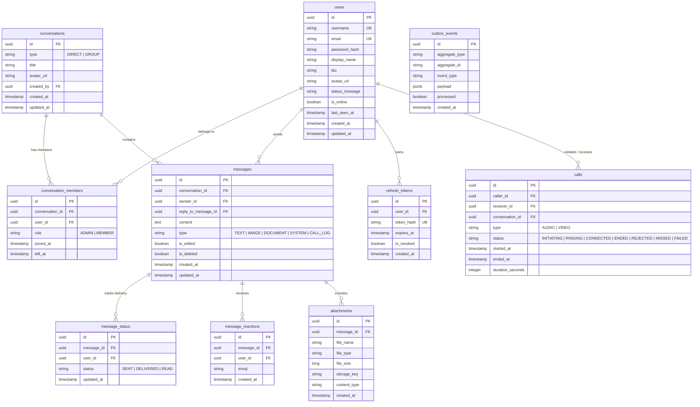
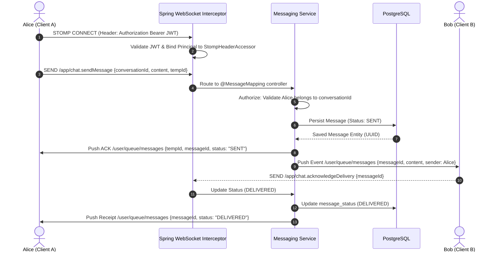
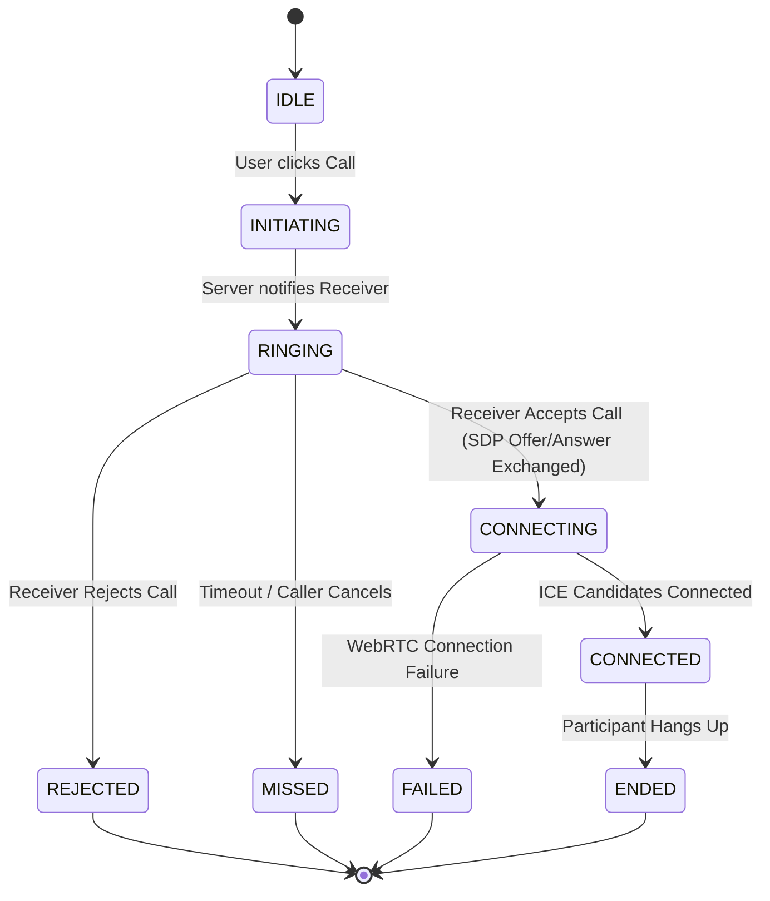

# VIORA - Architecture Specification & System Design

Viora is a high-performance, real-time messaging and communication platform built with Java 25, Spring Boot, PostgreSQL, Redis, Apache Kafka, React, TypeScript, STOMP WebSockets, and WebRTC.

---

## 1. System Overview & Monolith Design

Viora follows a **Modular Monolith** pattern. All components reside within a unified deployment artifact while maintaining strict module boundaries. This guarantees high developer velocity, ACID transaction capabilities across persistent boundaries, and zero network latency overhead between core services, while maintaining a clear upgrade path to distributed microservices if required in the future.



---

## 2. Backend Module Hierarchy

The backend application (`com.viora`) is structured into clean domain modules:

```
com.viora/
├── VioraApplication.java
├── common/             # Shared DTOs, Exception Handlers, Security Context, Outbox Entity
├── auth/               # User Registration, Login, Logout, JWT Token Providers, Auth Filters
├── user/               # User Profiles, Contact Directory, Search, User Settings
├── conversation/       # Direct & Group Conversation Management, Membership Validation
├── messaging/          # Message Creation, History Pagination, Editing/Deletion, Receipts, Reactions
├── group/              # Group Creation, Admin Roles, Member Operations, Permission Guards
├── presence/           # Redis-backed User Online/Offline Tracker, Heartbeat Monitor, Session Tracking
├── signaling/          # WebRTC SDP Offer/Answer Routing, ICE Candidates, Call State Machine
├── attachment/         # Storage Abstraction (Local/S3), MIME Validation, Signed Download Links
└── notification/       # Notification Preferences, Async Kafka Notification Listeners
```

### Module Boundary Rules
1. Modules **must never** directly access entities of another module across domain contexts.
2. Cross-module queries are executed via dedicated module **Service Interfaces** or shared DTOs.
3. Database transactions modifying core entity states must commit local data and emit an **Outbox Event** within the same database transaction.

---

## 3. Database Schema & Data Modeling

PostgreSQL serves as the primary relational database. Flyway manages versioned database migrations (`backend/src/main/resources/db/migration/`).



---

## 4. Real-Time STOMP Protocol & Channel Authorization

Real-time events utilize **STOMP over WebSocket** endpoints configured at `/ws`.

### Channel Destination Taxonomy
* `/user/queue/messages` - User-private real-time incoming messages, status receipts, and notifications.
* `/user/queue/signaling` - WebRTC offer/answer/ICE candidate messages.
* `/user/queue/presence` - Direct presence state changes of contacts.
* `/topic/conversations.{conversationId}` - Broadcast events for active conversation members (e.g., typing indicators).



---

## 5. WebRTC Voice & Video Call State Machine

Calls are managed via a dedicated WebRTC signaling state machine backed by STOMP signaling frames.



### Signaling Frame Structure
```json
{
  "type": "OFFER | ANSWER | ICE_CANDIDATE | REJECT | CANCEL | END",
  "callId": "uuid-v4-call-id",
  "senderId": "uuid-v4-user-id",
  "receiverId": "uuid-v4-target-id",
  "mediaType": "AUDIO | VIDEO",
  "sdp": "v=0\r\no=- ...",
  "candidate": { "candidate": "...", "sdpMid": "0", "sdpMLineIndex": 0 }
}
```

---

## 6. Online Presence & Session Engine (Redis)

Multi-device and multi-tab online presence tracking is executed in Redis to avoid persistent database thrashing:

* Key Schema: `presence:user:{userId}:sessions` (Redis Set containing active `sessionId` values)
* User Last Seen Key: `presence:user:{userId}:last_seen` (String epoch timestamp)
* Heartbeat TTL: 30 seconds.
* **Online Logic:** User is considered `ONLINE` if `SCARD presence:user:{userId}:sessions > 0`.
* **Disconnect Logic:** When a session disconnects, `SREM presence:user:{userId}:sessions {sessionId}` is run. If `SCARD` drops to 0, `is_online` is set to `false`, `last_seen` is updated, and a presence update event is dispatched.

---

## 7. Transactional Outbox Pattern for Kafka Async Events

To prevent state inconsistencies between PostgreSQL transactions and Kafka message dispatching (e.g. sending notification emails or analytics events), Viora uses the **Transactional Outbox Pattern**:

1. Business operations perform database changes and insert an `OutboxEvent` entity into `outbox_events` table inside the **same ACID transaction**.
2. A lightweight background Scheduled Service (`OutboxPublisher`) queries unprocessed outbox events, publishes them to Kafka topics (`viora.messages`, `viora.notifications`, `viora.analytics`), and marks events as `processed = true`.
3. Kafka consumers are strictly **idempotent**, checking deduplication caches prior to handling.

---

## 8. Frontend Design System & UI Palette

Viora features a refined **Whitish-Purple visual identity**:

* **Main Background (`bg-primary`):** `#F8F7FC`
* **Surface Panel (`bg-surface`):** `#FFFFFF`
* **Secondary Surface (`bg-secondary`):** `#F3F0FA`
* **Primary Accent Lavender (`accent-purple`):** `#8B5CF6`
* **Deep Purple (`accent-deep`):** `#6D42D8`
* **Light Lavender (`light-purple`):** `#EDE7FF`
* **Primary Text (`text-primary`):** `#252238`
* **Secondary Text (`text-secondary`):** `#77738B`
* **Borders (`border-subtle`):** `#ECE9F3`
