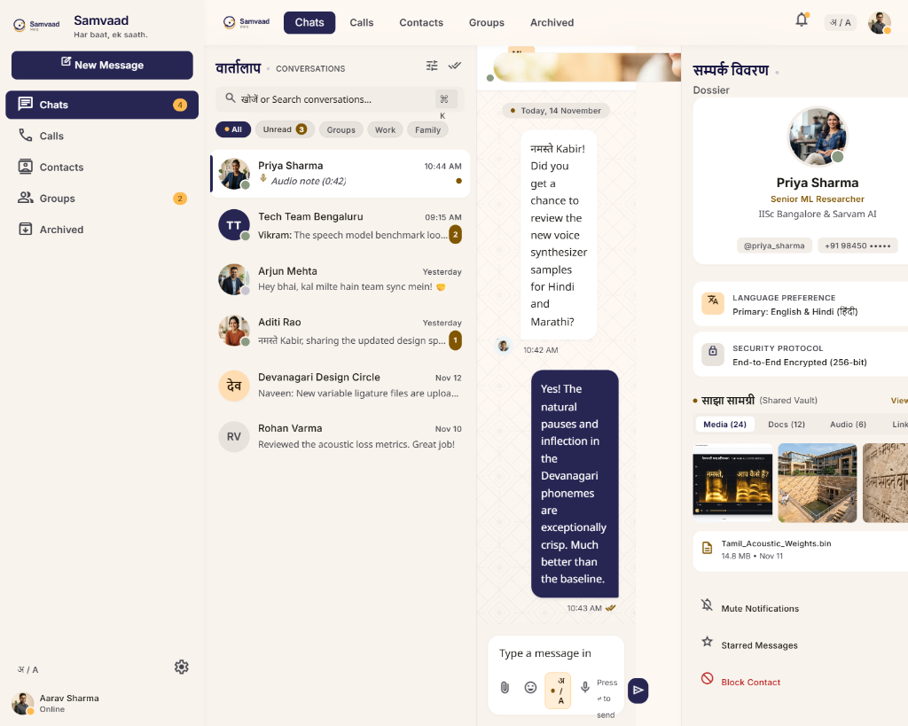
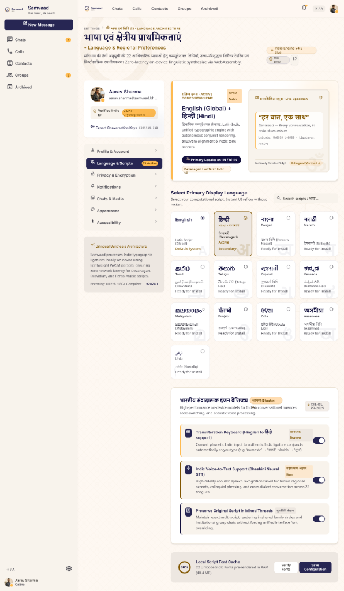
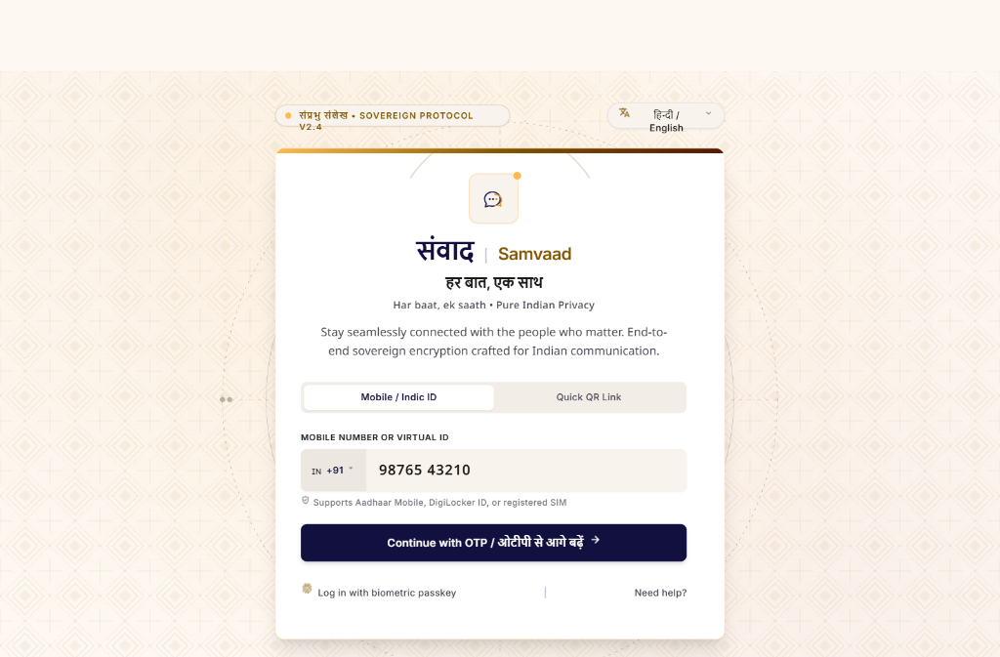
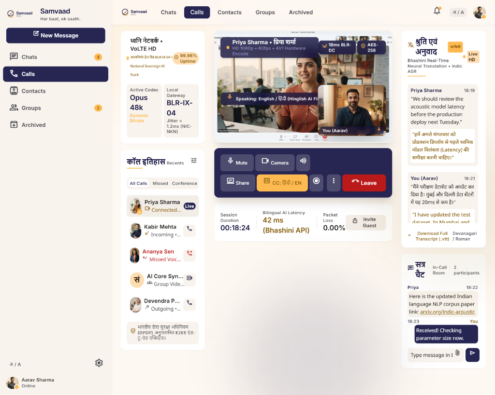

# SAMVAAD (संवाद) — Every Connection Has a Story

> **"Har baat, ek saath."**

### 🌐 Live Production Deployment
* **Live Web App**: [https://samvaad-wheat.vercel.app](https://samvaad-wheat.vercel.app)
* **Backend API & WebSocket**: [https://samvaad-l9lg.onrender.com](https://samvaad-l9lg.onrender.com)
* **Database**: PostgreSQL 16 (Supabase IPv4 Pooler)

Samvaad is an enterprise-grade, sovereign, high-concurrency real-time communication platform built with modern Java 25 backend architecture, React 18 + Vite frontend, PostgreSQL persistence, Redis presence tracking, Apache Kafka event streaming, STOMP WebSockets, WebRTC voice/video calling with screen sharing, DigiLocker E2EE sovereign document vault, in-chat UPI instant payments, and the Bhashini Indic AI translation engine.



---

## 📸 Sovereign Design System & User Interfaces

| **1. वार्तालाप एवं संपर्क विवरण (Chat & Starred Dossier)** | **2. भाषा एवं क्षेत्रीय प्राथमिकताएं (Indic AI Engine)** |
|:---:|:---:|
|  |  |
| **3. संप्रभु संलेख प्रवेश (Sovereign Phone/Email OTP Auth)** | **4. उच्च गुणवत्ता वीडियो संवाद (VoLTE HD Calls & Screen Share)** |
|  |  |

---

## 🌟 Comprehensive Feature Suites

### 1. WhatsApp & Telegram Core Experience
* 📌 **Pinned Chats (Top 5):** Pin up to 5 priority conversations with persistent server ordering and gold pin indicator badge.
* ⭐ **Starred Messages:** Bookmark critical messages and review them anytime inside the dedicated **चिह्नित (Starred)** dossier tab.
* 📋 **Message Status Checkmarks:**
  * **Single Gray (`✓`)**: Sent to server & persisted in PostgreSQL.
  * **Double Gray (`✓✓`)**: Delivered to recipient client.
  * **Double Blue (`✓✓`)**: Read by recipient with real-time STOMP state propagation.
* ⏳ **Disappearing Messages & Ephemeral Media:**
  * Configurable self-destruct timers (24h, 7 days, 90 days) per conversation with header notice.
  * **"View Once" Photos & Audio:** One-time reveal media that self-destructs immediately after closing.
* 📁 **Chat Folders / Custom Tabs:**
  * Categorize conversations instantly: **सभी (All)**, **व्यक्तिगत (Personal)**, **कार्य (Work)**, **समूह (Groups)**, **अपठित (Unread)**.
* ⭕ **24h Ephemeral Status & Stories (WhatsApp & Telegram style):**
  * Dedicated **Status (स्थिति)** navigation icon and horizontal stories carousel above conversations.
  * Post text statuses with 6 vibrant sovereign gradient themes or upload photo stories with captions.
  * Full-screen immersive story viewer with animated progress timer bars, tap navigation, pause-on-hold, and status deletion.
* 🎨 **Per-Conversation Chat Wallpapers & Themes:**
  * Customize chat backgrounds individually per friend, family member, or group.
  * 7 handcrafted sovereign presets (Classic Sovereign Ivory, Chat Doodle, Midnight Galaxy, Royal Indic Mandala, Misty Forest, Sunset Twilight, Ocean Depths).
  * Upload custom images from device or paste web links with built-in readability dimming slider (0%–75%).
  * Option to apply exclusively to active conversation or set as global default.
* 👤 **Sovereign Avatar Studio & Generative Personas:**
  * Integrated Avatar Studio with DiceBear vector engines (`Adventurer`, `Bottts`, `Fun Emoji`, `Lorelei`).
  * 🎲 Live AI Randomizer generates unique vector avatars on the fly from custom seed phrases.
  * Local photo file upload with client-side image processing, external URL support, and instant profile persistence.
* 💬 **Quote-Reply & Forwarding:**
  * Quote-reply with live snippet preview banners.
  * Forwarded messages carry a styled `प्रेषित (Forwarded)` tag.

### 2. Voice & Video Calling (WebRTC Mesh)
* 🖥️ **Screen Sharing (WhatsApp / Discord style):** 1-click desktop/tab screen sharing with audio and video stream relay.
* 📞 **Instant Meet / Shareable Call Links:** Generate shareable meeting URLs (`http://localhost:5173/?call={id}`) so users can join immediately.
* 🎙️ **VoLTE HD Audio & Adaptive Video:** Peer-to-peer browser calling with STOMP signaling server, STUN/TURN (Coturn) NAT traversal, noise suppression, and low-data modes.
* 🪟 **Floating Picture-in-Picture (PiP):** Minimize calls to continue chatting while keeping audio/video streams live.

### 3. Media, Sharing & Sovereign Vault
* 🚀 **High-Capacity File Transfer:** Transfer high-resolution photos, documents, and videos up to **500MB - 2GB** with inline progress tracking.
* 🎵 **In-Chat Audio Player with Waveform Scrubbing:** Listen to voice notes and audio clips with `1.0x` / `1.5x` / `2.0x` playback speed cycling.
* 🏛️ **DigiLocker / Sovereign Document Vault:** Verified storage and in-chat sharing of government documents (Aadhaar, PAN, Driving License, Degree Certificates) with E2EE badges.
* 💸 **UPI Instant Payments:** Send money requests directly inside conversations via deep links (`upi://pay?pa=...&pn=Samvaad&am=...&cu=INR`).

### 4. Bhashini AI & Indic Smart Features
* 🌐 **1-Tap Real-time Translation:** Translate incoming messages into Hindi, Bengali, Tamil, Telugu, Marathi, Punjabi, Gujarati, Kannada, Malayalam, or English.
* 🎙️ **Voice-to-Text Transcription:** 1-tap **भाषिणी वाक्-से-पाठ (Transcribe)** button to read voice notes in text.
* ⌨️ **Phonetic Hinglish Transliteration:** Typing English characters automatically suggests Devanagari script (e.g., `namaste` ➔ `नमस्ते`, `dhanyawad` ➔ `धन्यवाद`).
* ✨ **AI Smart Conversation Summarizer (TL;DR):** 1-click **AI सारांश** button in the chat header to catch up on unread group messages.

---

## 🛠️ Technology Stack

| Layer | Technologies |
|---|---|
| **Backend** | Java 25 LTS, Spring Boot 3.4.2, Spring Security 6, Spring Data JPA, Flyway |
| **Real-time Messaging** | Spring WebSocket, STOMP protocol, SockJS fallback |
| **Databases & Cache** | PostgreSQL 16 (Durable data), Redis 7 (Presence & Heartbeats) |
| **Event Streaming** | Apache Kafka 3.8 (Transactional Outbox Pattern) |
| **Media & Storage** | Multipart 500MB storage, File system / S3 abstraction |
| **VoIP & Video** | WebRTC APIs, Coturn STUN/TURN relay |
| **Frontend** | React 18, TypeScript (Strict Mode), Vite, Tailwind CSS, Lucide Icons |
| **Internationalization** | i18next (10 Scheduled Indian Languages) |
| **Authentication** | Mobile Phone OTP (Firebase Phone Auth / Local SMS Gateway), Email OTP, BCrypt |

---

## 🚀 Installation & Local Setup

### Prerequisites
Make sure the following tools are installed on your machine:
* **Java JDK 21 or 25** (`java -version`)
* **Node.js v20+ & npm** (`node -v`)
* **Apache Maven 3.9+** (`mvn -v`)
* **Docker Desktop / Docker Engine** (`docker -v`)

---

### Step 1: Clone the Repository
```bash
git clone https://github.com/satyamk001-tech/Samvaad-.git
cd Samvaad-
```

### Step 2: Configure Environment Variables
Copy the template configuration files:
```bash
# Root environment
cp .env.example .env

# Frontend environment
cp frontend/.env.example frontend/.env
```
*(Optional)* Add your Firebase credentials in `frontend/.env` if using Firebase Phone Authentication.

### Step 3: Start Infrastructure Services (Docker)
Start PostgreSQL, Redis, Kafka, and Coturn using Docker Compose:
```bash
docker-compose up -d
```
Verify containers are running:
```bash
docker ps
```
Services started:
* **PostgreSQL:** `localhost:5432` (`samvaaddb`)
* **Redis:** `localhost:6379`
* **Apache Kafka:** `localhost:9092`
* **Coturn STUN/TURN:** `localhost:3478`

### Step 4: Run the Backend (Spring Boot)
Open a terminal in the root directory:
```bash
cd backend
mvn clean spring-boot:run
```
* The backend will start on **`http://localhost:8080`**.
* Flyway migrations (`V1`, `V2`, `V3`) will automatically apply all database tables.
* Health check: `http://localhost:8080/actuator/health`

### Step 5: Run the Frontend (React + Vite)
Open a new terminal window:
```bash
cd frontend
npm install
npm run dev
```
* The application will launch on **`http://localhost:5173/`**.

---

## 🧪 Testing & Verification

### Backend Tests
```bash
cd backend
mvn test
```

### Frontend Build Verification
```bash
cd frontend
npm run build
```

---

## 📜 Architectural Decisions & Security Directives
1. **Zero Hardcoded Credentials:** All credentials driven strictly by `.env` and Spring environment properties.
2. **Durable Message State:** Messages are committed to PostgreSQL with `SENT` status before durable WebSocket receipts are returned.
3. **Session Sovereignty:** Identity is always derived from authenticated `SecurityContext` / `StompHeaderAccessor` rather than client-supplied IDs.
4. **Data Sovereignty:** Local data persistence with E2EE sovereign encryption designed for Indian citizen infrastructure.

---

## 🤝 Contributing
1. Fork the repository.
2. Create your feature branch (`git checkout -b feature/amazing-feature`).
3. Commit your changes (`git commit -m 'feat: add amazing feature'`).
4. Push to the branch (`git push origin feature/amazing-feature`).
5. Open a Pull Request.

---

## 📄 License
This project is licensed under the MIT License - see the LICENSE file for details.
