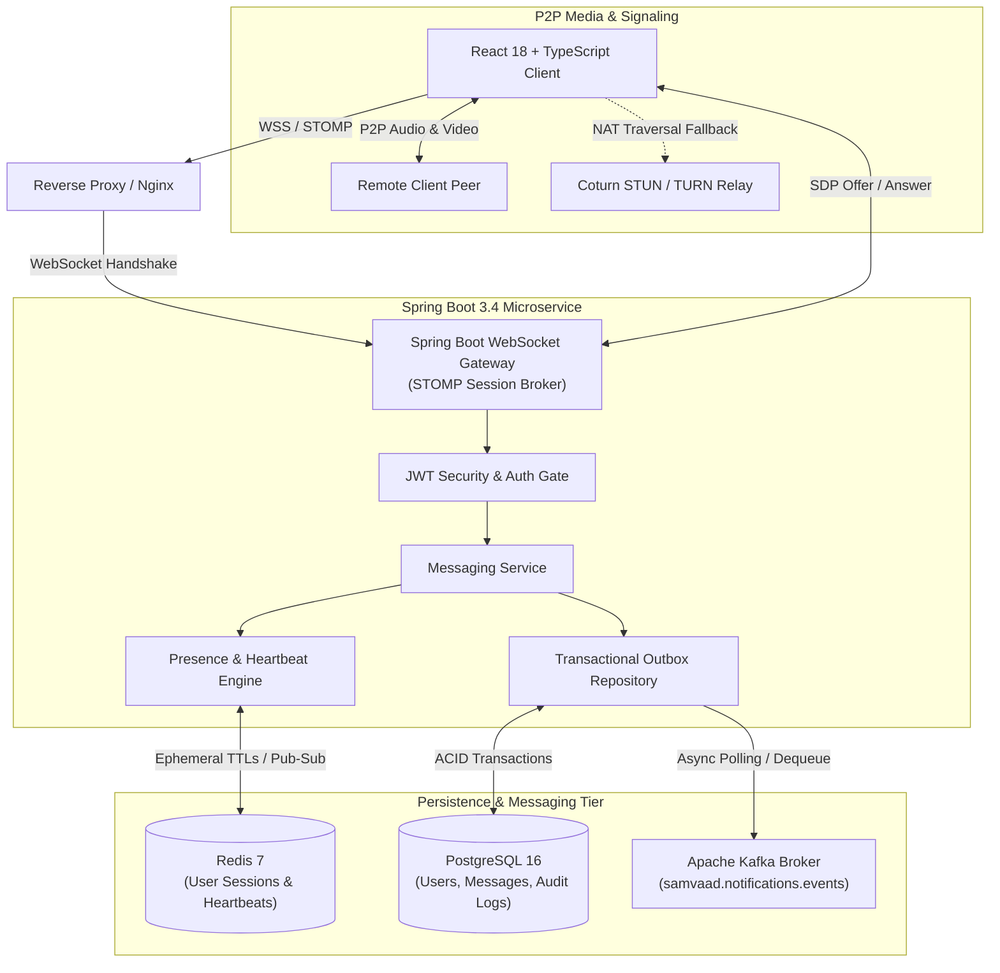

# Samvaad (संवाद)
## High-Concurrency Distributed Real-Time Communication Platform

[](https://openjdk.org/)
[](https://spring.io/projects/spring-boot)
[](https://stomp.github.io/)
[](https://www.postgresql.org/)
[](https://redis.io/)
[](https://kafka.apache.org/)
[](LICENSE)

Samvaad is an enterprise-grade real-time messaging and media communication backend designed for horizontal scalability, sub-50ms message propagation, and resilient fault isolation.

---

### Architectural Design



---

### Core Engineering Capabilities

1. **Stateful WebSocket Management with Ephemeral Redis Heartbeats**:
   - Clients maintain a persistent STOMP over WebSocket connection (`/ws-samvaad`).
   - Active user presence is registered in Redis with a 60-second Time-to-Live (TTL). Heartbeat frames renew leases; disconnect handlers evict presence immediately to notify mutual contacts.
2. **Distributed Messaging via Transactional Outbox Pattern**:
   - Solves distributed dual-write inconsistency between relational state and Kafka message brokers.
   - Message payloads and outbound notification events are committed in a single atomic database transaction. A decoupled worker processes pending records with exponential backoff retries.
3. **WebRTC Signaling & NAT Traversal**:
   - Peer-to-peer audio/video streaming negotiated via WebSocket SDP offer/answer exchanges.
   - Integrated STUN/TURN fallback relays encrypted media streams across restrictive symmetric NATs and firewalls.
4. **Stateless Security Architecture**:
   - Dual-token authentication (short-lived HMAC-SHA256 JWT access token + refresh token rotation in HttpOnly cookies).
   - Strict input validation with magic-byte file inspection rejecting disguised executables.

---

### Local Installation & Quickstart

#### Prerequisites
- **Java 21 LTS** (`java -version`)
- **Maven 3.9+** (`mvn -v`)
- **Docker & Docker Compose** (`docker compose version`)
- **Node.js 20+** (`node -v`)

#### 1. Clone Repository & Start Containers
```bash
git clone https://github.com/satyamk001-tech/Samvaad.git
cd Samvaad

# Start PostgreSQL (5432), Redis (6379), and Kafka (9092)
docker compose up -d
```

#### 2. Configure Environment
```bash
cp .env.example .env
# Edit .env and supply a secure JWT_SECRET
```

#### 3. Compile & Run Backend Tests
```bash
cd backend
mvn clean test
mvn spring-boot:run
```
Backend starts on `http://localhost:8080`.  
Health endpoint: `http://localhost:8080/actuator/health`

#### 4. Run Frontend Development Server
```bash
cd ../frontend
npm install
npm run dev
```
Frontend accessible at `http://localhost:5173`.
